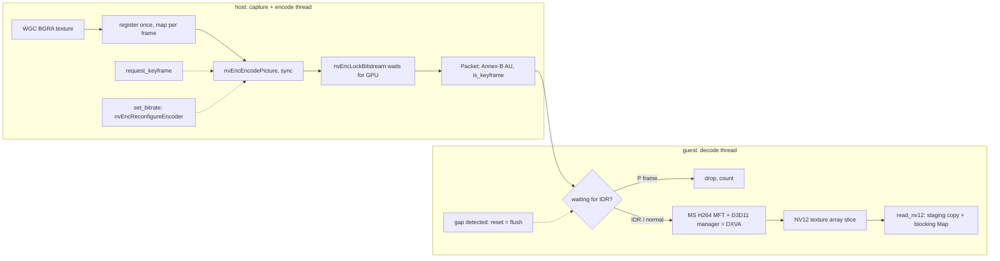

# Live H.264: NVENC (D3D11 in) → WMF DXVA (D3D11 out)

Low-latency window share: `mediaway_encoder::nvenc::NvencLiveEncoder` →
`mediaway_decoder::windows::WmfLiveH264Decoder`. ADRs: encoder
[`adr/nvenc/0002`](../../../../crates/mediaway-encoder/adr/nvenc/0002-live-h264-session.md),
decoder [`adr/windows/0007`](../../../../crates/mediaway-decoder/adr/windows/0007-wmf-live-h264-decode.md).
Measured latencies: encoder `docs/nvenc/roadmap.md` stage 5, decoder `docs/windows/roadmap.md`
stage 9.

## Findings

- **No hardware H.264 *decoder* MFT on NVIDIA / Intel.** `MFT_ENUM_FLAG_HARDWARE` finds only
  encoders; GPU H.264 decode is the inbox sync MFT given `MFT_MESSAGE_SET_D3D_MANAGER`. That is
  why the old ZC path (`wmf/h264.rs` + `dx11.rs`) is `Unsupported` on the 4090. Proof of GPU
  decode: `MFT_OUTPUT_STREAM_PROVIDES_SAMPLES`, DXGI-backed samples, `D3D11_BIND_DECODER`.
- `MF_LOW_LATENCY` + a B-frame-free stream: frame *n* comes out of `push_packet(n)`.
- NVENC's RGB → YUV matches **BT.709** limited (decoded luma 47 dB vs a 709 reference, 28 dB
  vs 601); the encoder writes that VUI.
- The `nvenc` 0.1 crate cannot do live mode (no reconfigure, no pic flags, private RC / H.264
  fields, panics in `Drop`): the live path has its own SDK 13.0 FFI with `const` layout asserts
  (numbers dumped with `clang-cl` from `nv-codec-headers` `n13.0.19.0`). Keep the dump program
  under `local/` if the SDK version moves.
- Decoder texture slices belong to the MFT's small pool: one held frame, released on the next
  push / poll / reset.

## Gotchas

- `NvencLiveEncoder` registers caller textures and keeps a COM ref (cache of 8); after
  `resize` the cache is dropped, so an old-size texture is `InvalidInput`.
- `read_nv12` reads the *last polled* frame; poll again and it is gone.
- Sender and receiver may share a device, but the test uses two devices (like two machines).
